# Веб отчётность

Учёт аварий на базовых станциях (БС) сотовой сети и ежедневная отчётность технических центров. Кейс №02 ООО «Екатеринбург 2000» (Мотив), команда ВайбКодерс.

## Рабочая версия

**Production:** [Веб отчётность](https://vm-332465b3.na4u.ru)

Работающая версия приложения развёрнута на сервере и доступна через веб-интерфейс.


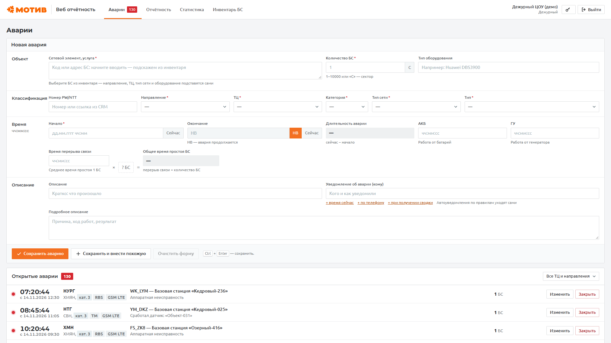

Дежурный выбирает объект из инвентаря, и форма сама подставляет направление, ТЦ, тип сети и оборудование. Длительность и общий простой считаются автоматически. Открытые аварии видны на табло с живыми таймерами. Отчёт строится за любой период и выгружается в CSV или в Excel в формате сводки ЦОУ. Уведомления и ежедневная сводка за смену уходят письмом через почтовый сервер компании.

## Содержание

- [Быстрый старт](#быстрый-старт)
- [Где что находится](#где-что-находится) — экраны по порядку работы, куда нажимать
- [Как считается и как устроено](#как-считается-и-как-устроено)
- [Структура базы данных](#структура-базы-данных)
- [CSV и Excel](#csv-и-excel)
- [Установка на сервер](#установка-на-сервер)
- [Настройки (.env)](#настройки-env)
- [API](#api)
- [Роли](#роли)
- [Разработка](#разработка): локальный запуск, тесты, релизы, Chrome 75
- [Где что в коде](#где-что-в-коде)

Подробные документы:
- [Руководство пользователя](docs/РУКОВОДСТВО.md) — по ролям;
- [Установка и эксплуатация](docs/УСТАНОВКА.md) — сервер, HTTPS, почта, резервные копии, проверки;
- [API](docs/API.md);
- [Изменения](CHANGELOG.md).

Все скриншоты сняты в Full HD на демо-данных и лежат в [docs/screenshots](docs/screenshots).

## Быстрый старт

```bash
cp .env.example .env              # задайте пароли и JWT_SECRET
docker-compose up -d --build      # Compose v1; в v2 — docker compose up -d --build
```

- Интерфейс: `http://<сервер>`. Порт — `APP_PORT`, по умолчанию 80.
- База MariaDB работает во внутренней сети Docker и наружу не открыта.
- Первый вход — `ADMIN_LOGIN` / `ADMIN_PASSWORD` из `.env`.

**Демо-режим** включается так: `SEED_DEMO=true` в `.env` до первого запуска. Будут созданы:
- пользователи `duty/duty` (дежурный) и `engineer/engineer` (инженер);
- инвентарь из 475 объектов в формате сводки ЦОУ, например `VJ_K29 — Базовая станция «Кедровый-110»`;
- около 1550 аварий: строки обезличенной сводки ЦОУ, сдвинутые к текущим суткам, и история за 60 дней в том же стиле;
- четыре правила уведомлений.

На экране входа в демо-режиме есть кнопки быстрого входа под каждой ролью.

## Где что находится

Меню наверху: **Аварии**, **Отчётность**, **Статистика**, **Инвентарь БС**. Администратор видит ещё пункт **Администрирование**. Справа в шапке — смена пароля и выход.

### Вход

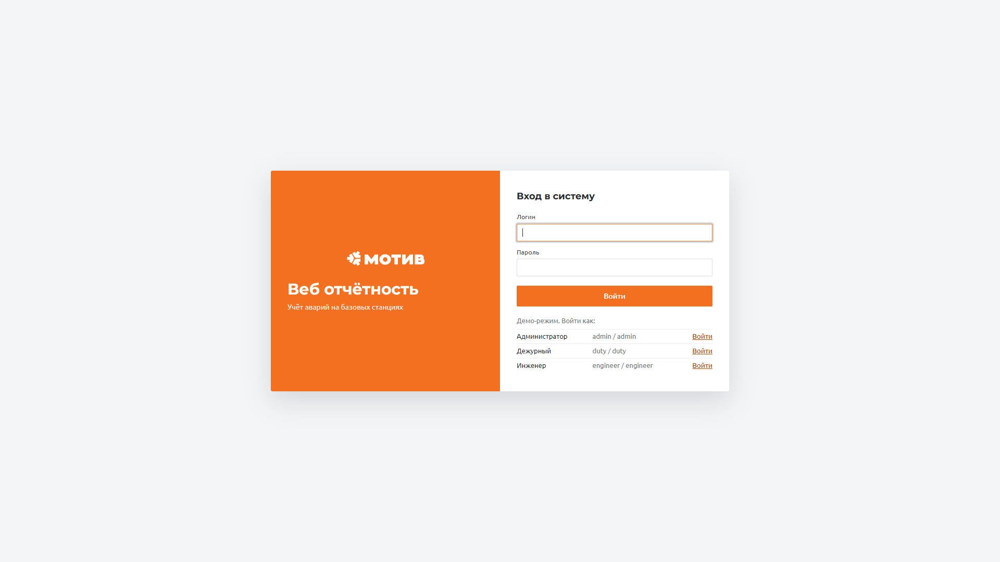

Логин и пароль выдаёт администратор.

### Аварии: новая авария и табло

Вверху страницы — форма **«Новая авария»**, под ней — **табло открытых аварий**, внизу — последние внесённые.

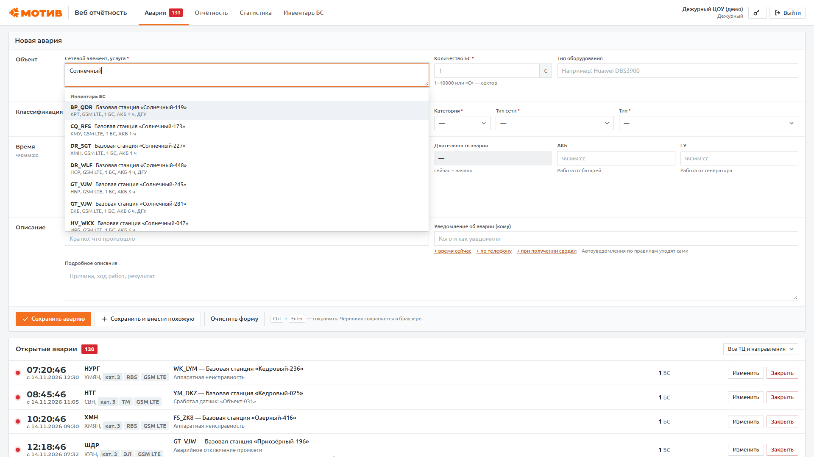

**Как внести аварию:**
1. «Сетевой элемент»: введите код или название объекта (`GT_VJW`, `Солнечный`) и выберите его из подсказки. Направление, ТЦ, тип сети, оборудование и количество БС подставятся сами.
2. Выберите тип аварии. Поле «Описание» подскажет частые формулировки для этого типа.
3. Начало — календарь или кнопка «Сейчас». Окончание — «НВ», если авария продолжается.
4. «Уведомление (кому)» — кого известили вручную. Есть быстрые вставки: «+ время сейчас», «+ по телефону», «+ при получении сводки».
5. Нажмите «Сохранить аварию». Для массовой аварии — «Сохранить и внести похожую»: следующая форма откроется с теми же полями.

Длительность и общий простой считаются сами. Черновик формы хранится в браузере. Дату в будущем форма не примет.

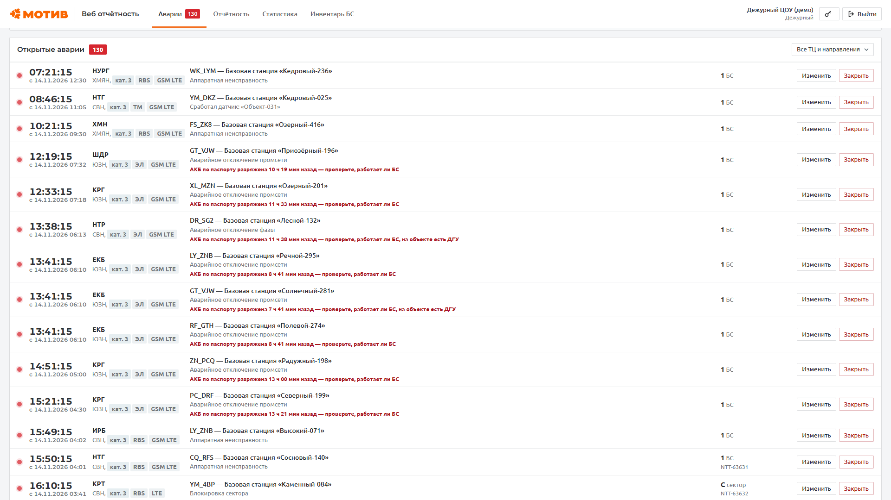

**Табло:**
- сверху — аварии, начавшиеся за последние сутки, новые первыми; таймеры идут каждую секунду;
- строка «Длятся больше суток» раскрывает переходящие аварии;
- справа в заголовке — отбор по ТЦ;
- у аварий по электропитанию — ориентировочный прогноз по паспортной автономности АКБ из инвентаря;
- «Изменить» открывает карточку, «Закрыть» ставит время окончания.

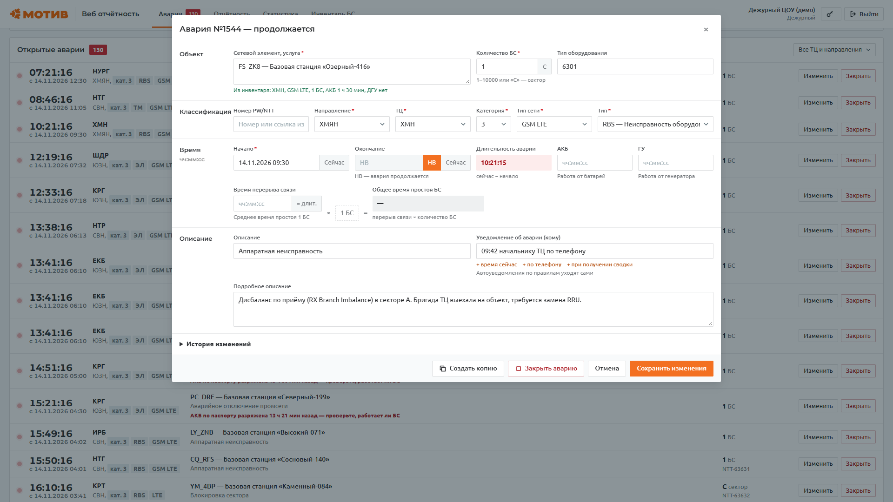

**Карточка аварии:**
- все 19 полей можно править;
- «Закрыть аварию», «Создать копию»;
- у администратора — «Удалить», авария уходит в корзину;
- внизу — отправленные уведомления и история изменений: кто, когда, что было и что стало.

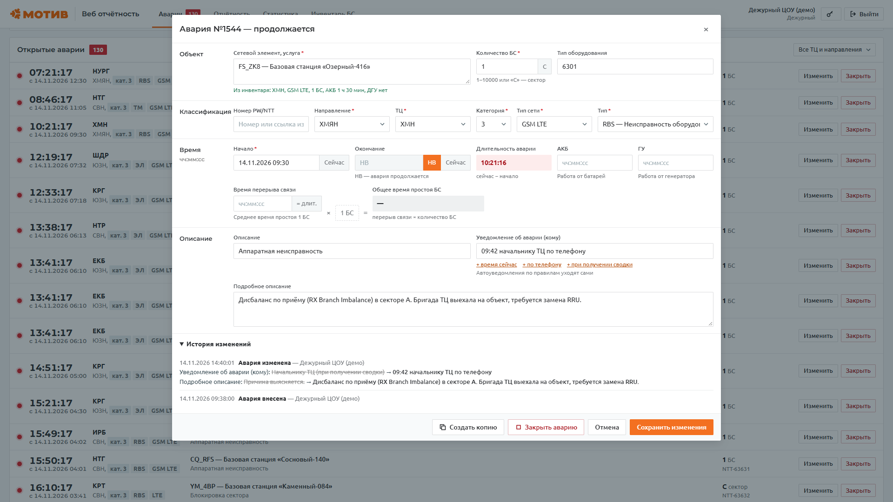

### Отчётность

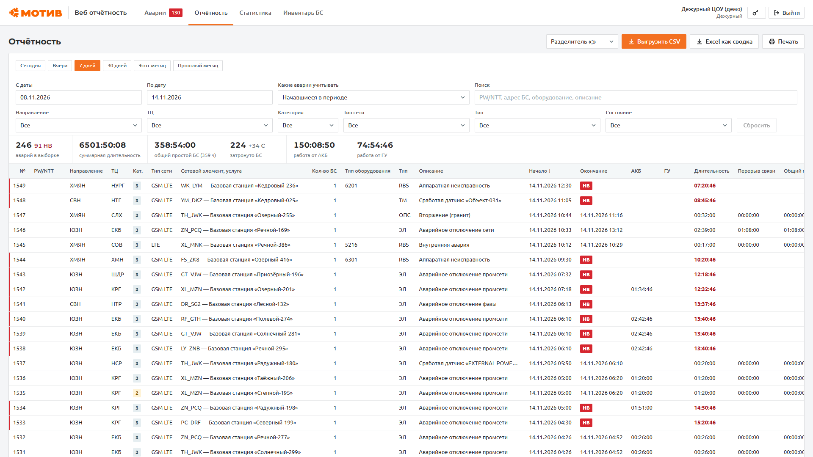

- Период: календарь или кнопки «Сегодня», «Вчера», «7 дней», «30 дней», «Этот месяц», «Прошлый месяц».
- «Какие аварии учитывать»:
  - «Начавшиеся в периоде»;
  - «Действовавшие» — сюда попадает и авария, которая открылась раньше и ещё длится.
- Фильтры: направление, ТЦ, категория, тип сети, тип аварии, состояние. Поиск — по PW/NTT, объекту, оборудованию и описаниям.
- Над таблицей — итоги по всей выборке. Нажатие на строку открывает карточку аварии.

Кнопки справа:
- **Выгрузить CSV** — разделитель на выбор;
- **Excel как сводка**;
- **Печать**;
- **Загрузить сводку** — только у администратора.

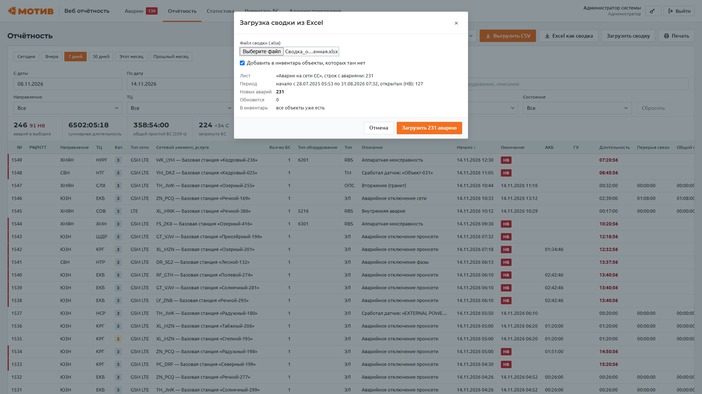

**Загрузка сводки:**
1. Выберите файл .xlsx с листом «Аварии на сети СС».
2. Программа сначала покажет, что будет сделано: сколько аварий новых, сколько обновится, какие объекты добавятся в инвентарь, какие строки с ошибками.
3. Нажмите «Загрузить».

Повторная загрузка обновлённой сводки не создаёт дублей: авария узнаётся по сетевому элементу и времени начала.

### Статистика

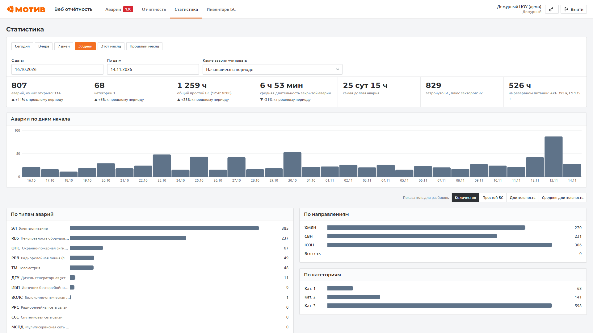

- Итоги за период и сравнение с предыдущим периодом той же длины.
- График по дням.
- Разбивки по типам аварий, направлениям, ТЦ, категориям и типам сети. Показатель на выбор: количество, простой, длительность, средняя длительность.

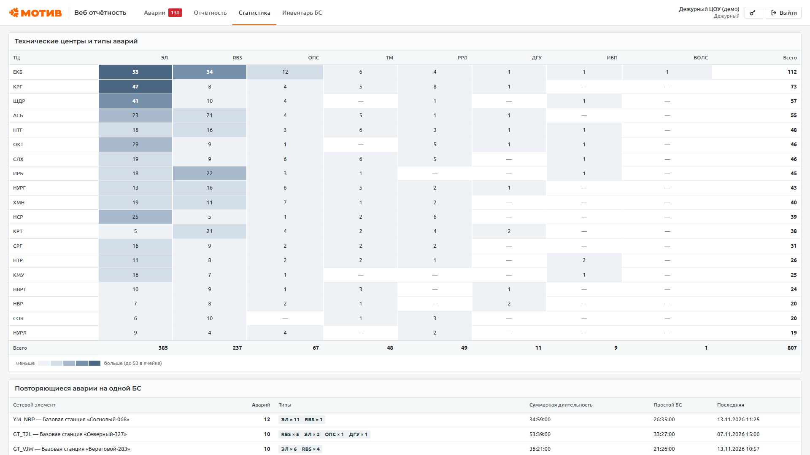

- Матрица «ТЦ × тип аварии».
- Повторяющиеся аварии на одной БС.
- Топ по простою.

Нажатие на столбец, ячейку или строку открывает отчёт с этим отбором.

### Инвентарь БС

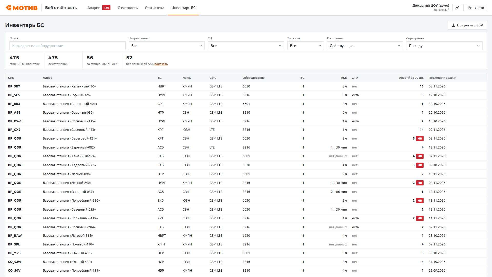

- Объекты в формате «код — название».
- Для каждого объекта: ТЦ, направление, сеть, оборудование, количество БС, автономность АКБ по паспорту, ДГУ, аварии за 90 дней и последняя авария.
- Выгрузка CSV — для всех ролей.
- Правка и загрузка CSV — администратор. Подойдёт выгрузка Site Info, таблица Excel или столбец «Сетевой элемент, услуга» из сводки.

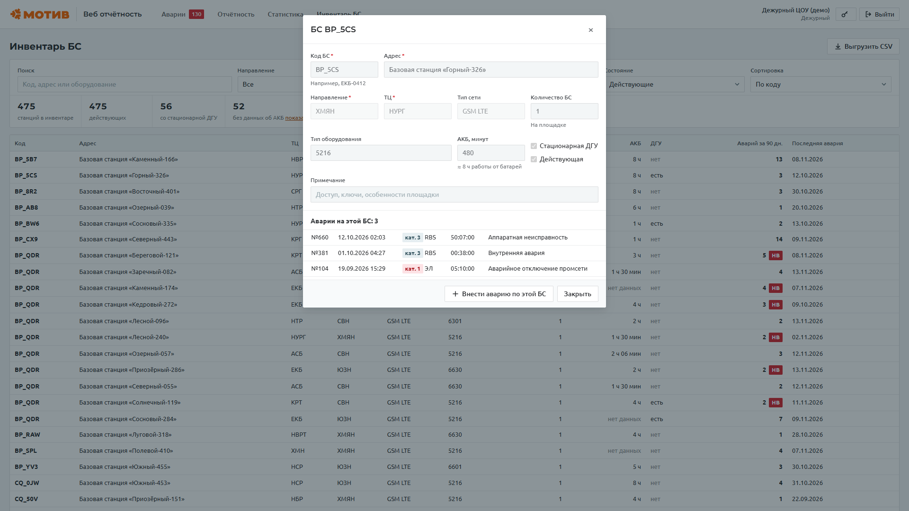

В карточке объекта — его последние аварии. Кнопка «Внести аварию по этой БС» открывает форму с уже заполненным объектом.

### Администрирование

**Пользователи** — создание, роль, отключение, новый пароль. Смена роли и отключение действуют сразу.

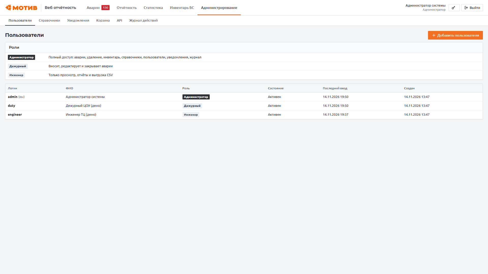

**Справочники** — направления, ТЦ, типы сети и типы аварий с расшифровками.
- Порядок в списке меняется стрелками.
- Переименование значения обновляет старые аварии.
- «Скрыть» убирает значение из формы, но оставляет в отчётах.
- Удалить можно только неиспользуемое значение.

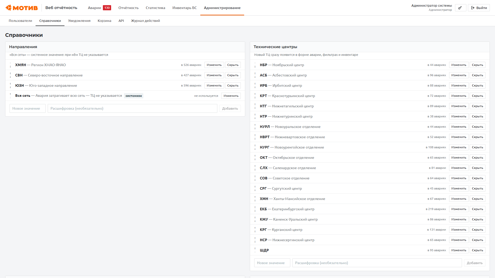

**Уведомления:**
- **почтовый сервер** — подключение к почте компании и адрес приложения для ссылок в письмах;
- **правила** — кому и о каких авариях сообщать;
- **журнал** — каждое сообщение с текстом и статусом; неотправленное можно отправить снова.

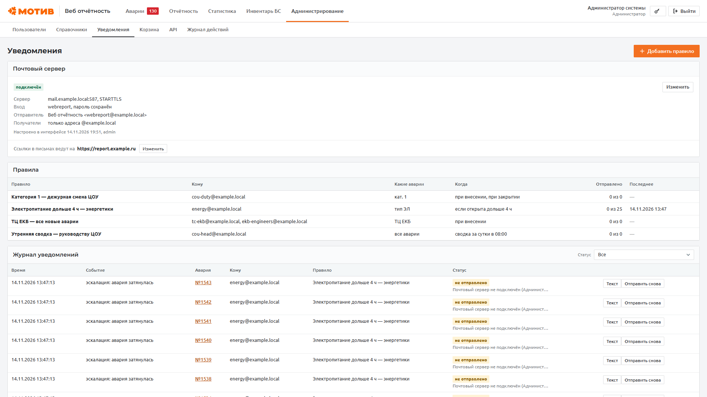

| Почтовый сервер компании | Правило уведомлений |
|---|---|
| 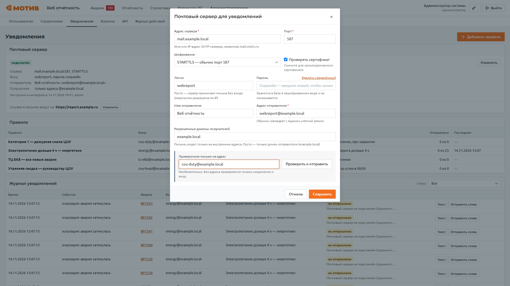 | 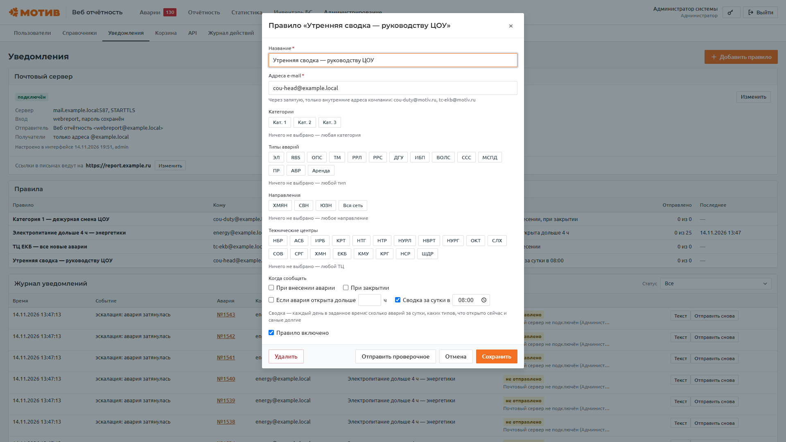 |

- **Почтовый сервер.** Адрес и порт, шифрование, логин, пароль, адрес отправителя и разрешённые домены получателей. Письма уходят только на внутренние адреса компании. «Проверить подключение» проверяет соединение и вход ещё до сохранения и может отправить проверочное письмо.
- **Правило.**
  - Получатели — внутренние адреса.
  - Отбор: категории, типы аварий, направления, ТЦ. Ничего не выбрано — подходит любое значение.
  - Когда сообщать: при внесении, при закрытии, если авария открыта дольше N часов, сводка за смену в заданное время.
  - «Отправить проверочное» присылает пример письма.

| Сводка за смену | Новая авария |
|---|---|
| 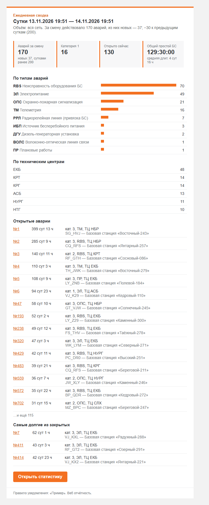 | 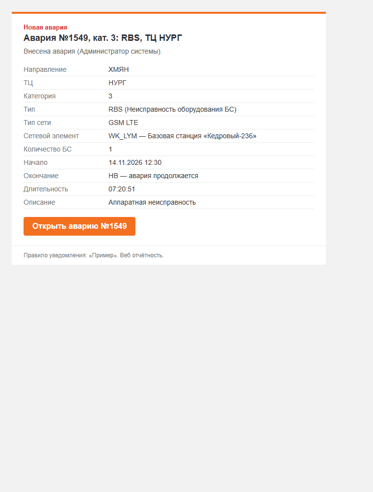 |

**Корзина** — удалённые аварии.
- В отчёты и статистику они не попадают.
- «Восстановить» возвращает аварию с прежним номером.
- «Удалить навсегда» стирает её окончательно; копия остаётся в журнале действий.

**API** — ключи доступа для внешних систем. «Документация API» открывает `/api/docs`.

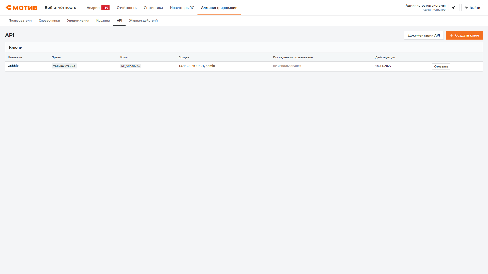

**Журнал действий** — все действия пользователей с отбором по периоду, действию и пользователю.

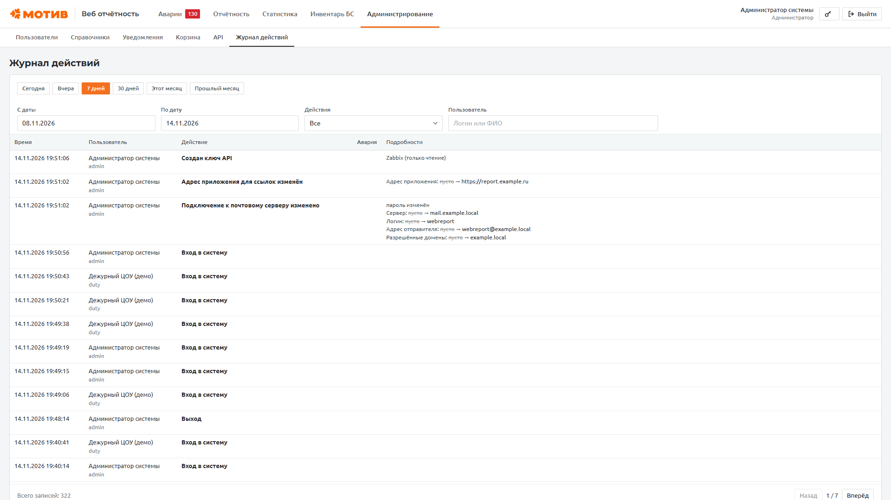

## Как считается и как устроено

- **Время.** Все даты вводятся и хранятся по времени центра (`APP_TZ`, по умолчанию `Asia/Yekaterinburg`). Интерфейс сверяет свои часы с сервером. Даты в будущем не принимаются; допуск — 5 минут на расхождение часов.
- **«НВ».** У открытой аварии в `END_TIME` хранится `0000-00-00 00:00:00`. Длительность открытых аварий сервер обновляет в базе раз в минуту, в интерфейсе она тикает каждую секунду.
- **Длительность** = окончание − начало, или «сейчас − начало» для открытой аварии.
- **Количество БС** — число от 1 до 10000 или «С» (сектор).
- **Общий простой БС** = время перерыва связи × количество БС; сектор считается как одна БС. Значение хранится текстом, без предела `838:59:59` у типа `TIME`.
- **«Вся сеть».** Если выбрано это направление, ТЦ не указывается.
- **Обязательные поля:** направление, ТЦ (кроме «Вся сеть»), категория, тип сети, сетевой элемент, количество БС, тип аварии, начало.
- **Удаление.** Удалить аварию может только администратор, и она уходит в корзину. Восстановить можно с прежним номером. Окончательное удаление тоже пишется в журнал.
- **Смена — 08:00–08:00.** Сводка за смену включает все аварии, которые действовали в эти сутки. Авария, открытая 13-го и закрытая 18-го, попадёт в сводку за 14-е.
- **Прогноз по АКБ** — ориентировочный: он считается по паспортной автономности из инвентаря, а реальная ёмкость батарей со временем падает.
- **Уведомления** — только e-mail и только на внутренние адреса. Список доменов задаётся в настройках почты; по умолчанию разрешён домен адреса отправителя. Если почта не подключена, сообщения остаются в журнале, и их можно отправить позже.
- **Ссылка на заявку.** Если в поле PW/NTT введён полный адрес, он открывается по клику. Если введён номер, ссылка строится по шаблону `CRM_URL_TEMPLATE`, например `https://jira.motiv.local/browse/{id}`.
- **Хранение.** Данные хранятся бессрочно. Резервные копии базы делаются каждую ночь, хранятся 30 последних.

## Структура базы данных

Схема — [db/init/01-schema.sql](db/init/01-schema.sql). Таблицы создаются при первом запуске. Изменения схемы для уже существующих баз приложение вносит само при старте ([server/src/db.ts](server/src/db.ts)).

**`alarms` — аварии** (19 полей ТЗ и номер записи):

| Столбец | Тип | Поле в интерфейсе |
|---|---|---|
| `ID` | INT, ключ | Номер аварии |
| `PW` | VARCHAR(450) | Номер PW/NTT |
| `NAPR` | VARCHAR(450) | Направление (справочник) |
| `TEHC` | VARCHAR(450) | ТЦ (справочник; пусто для «Вся сеть») |
| `KATEG` | TINYINT | Категория 1–3 |
| `NETW_TYPE` | VARCHAR(450) | Тип сети (справочник) |
| `SERV_ELEM` | VARCHAR(450) | Сетевой элемент, услуга: «код — название» |
| `NUMB_RBS` | VARCHAR(16) | Количество БС: число или «С» |
| `EQIP_TYPE` | VARCHAR(450) | Тип оборудования |
| `ALARM_TYPE` | VARCHAR(450) | Тип аварии (справочник) |
| `DESCR` | VARCHAR(450) | Описание |
| `BEGIN_TIME` | DATETIME | Начало |
| `END_TIME` | DATETIME | Окончание; `0000-00-00 00:00:00` — «НВ» |
| `AKB` | TIME | Работа от АКБ |
| `DGU` | TIME | Работа от ГУ |
| `LENGHT` | VARCHAR(450) | Длительность — считает сервер |
| `PROSTOY` | TIME | Время перерыва связи |
| `COMMON_PROSTOY` | VARCHAR(450) | Общий простой БС — считает сервер |
| `ALARM_WHO` | VARCHAR(450) | Уведомление об аварии (кому) |
| `DESC_NOTICE` | VARCHAR(450) | Подробное описание |

**Остальные таблицы:**

| Таблица | Что хранит |
|---|---|
| `alarms_deleted` | Корзина: те же столбцы, что у `alarms`, и `deleted_at`, `deleted_by` |
| `users` | Пользователи: логин, ФИО, роль (`admin`, `duty`, `engineer`), bcrypt-хэш пароля, активность, последний вход |
| `audit_log` | Журнал действий: время, кто, действие, номер аварии, подробности (JSON, для правок — «было → стало») |
| `dict_items` | Справочники: `napr`, `tehc`, `netw`, `type`; значение, расшифровка, порядок, скрыто или нет, системное или нет |
| `stations` | Инвентарь: код, название, ключ «код — название» (`elem_key`, уникальный), направление, ТЦ, сеть, оборудование, количество БС, автономность АКБ в минутах, наличие ДГУ |
| `notify_rules` | Правила уведомлений: получатели, отборы (категории, типы, направления, ТЦ), события, порог эскалации в часах, время сводки |
| `notify_log` | Журнал уведомлений: время, правило, авария, событие, получатели, тема, текст, статус (`sent`, `failed`, `skipped`), ошибка |
| `app_settings` | Настройки из интерфейса: почтовый сервер (пароль зашифрован AES-256-GCM), адрес для ссылок |
| `api_tokens` | Ключи API: название, права (`read` или `write`), SHA-256 ключа, срок действия, последнее использование |

## CSV и Excel

**CSV** («Отчётность → Выгрузить CSV»):
- кодировка UTF-8 с BOM — Excel открывает файл без настройки;
- разделитель на выбор: `;` (по умолчанию), `,`, табуляция или `|`;
- заголовки на русском, в порядке полей ТЗ;
- даты в формате `ДД.ММ.ГГГГ ЧЧ:ММ:СС`, открытое окончание — `НВ`, сектор — `С`.

**Экранирование** — по RFC 4180, поэтому разделитель внутри текста не ломает столбцы:
- значение, в котором встречается разделитель, кавычка или перенос строки, берётся в двойные кавычки;
- кавычка внутри значения удваивается: `Объект «А»; ввод "1"` → `"Объект «А»; ввод ""1"""`;
- текст, начинающийся с `=`, `+`, `-` или `@`, получает в начале апостроф, чтобы Excel не выполнил его как формулу.

Если файл открывают не в Excel, а в программе, которая не понимает кавычки, выберите разделитель `|`: в тексте аварий он почти не встречается.

**Excel как сводка** — файл .xlsx в формате сводки ЦОУ:
- лист «Аварии на сети СС», та же двухстрочная шапка и строка номеров столбцов 1–19;
- даты и длительности — в форматах Excel, открытые аварии отмечены «НВ»;
- такой файл можно загрузить обратно через «Загрузить сводку».

## Установка на сервер

Docker Hub на сервере может быть недоступен. Поэтому образы собираются заранее и переносятся одним архивом.

1. **Комплект.** Готовый `webreport-<версия>.tar.gz` есть в GitHub Releases: он собирается автоматически по тегу `v*`. Можно собрать и самостоятельно на машине с Docker: `sh deploy/build-bundle.sh 1.0.0` → `dist-bundle/`.
2. **Установка на сервере:**
   ```bash
   tar xzf webreport-1.0.0.tar.gz && cd webreport-1.0.0
   sh deploy/install.sh            # для демо-стенда: SEED_DEMO=true sh deploy/install.sh
   ```
   Скрипт загрузит образы и при первом запуске создаст `.env` со случайными паролями. Затем он поднимет контейнеры и выведет пароль администратора.
3. **Почта:** «Администрирование → Уведомления → Почтовый сервер».
4. **Обновление:** распакуйте новый комплект в тот же каталог и снова выполните `sh deploy/install.sh`. Данные базы, `.env` и сертификаты сохраняются.

**HTTPS** работает в двух вариантах:
- **Сертификат в приложении.** Положите `certs/server.crt` и `certs/server.key`: корпоративный сертификат, Let's Encrypt или самоподписанный (`sh deploy/make-cert.sh <имя-или-IP>`). После этого приложение слушает 443, перенаправляет HTTP на HTTPS, ставит cookie с флагом `Secure` и включает HSTS.
- **TLS на балансировщике.** Задайте `TRUST_PROXY` (адрес балансировщика или число прокси) и `COOKIE_SECURE=true`.

**Остальное:**
- Порты меняются переменными `APP_PORT` и `HTTPS_PORT`.
- Порт базы 3306 по умолчанию закрыт. `DB_EXPOSE=1` открывает его на `DB_BIND:DB_PUBLIC_PORT`, по умолчанию на `127.0.0.1`.
- Резервные копии:
  - `sh deploy/backup.sh` — копия в `backups/`, хранятся 30 последних;
  - `sh deploy/backup.sh restore backups/<файл>.sql.gz` — восстановление.
- Состояние и журнал: `sh deploy/compose.sh ps`, `sh deploy/compose.sh logs -f app`. Обёртка сама выбирает `docker-compose` или `docker compose`.
- Установка по SSH одной командой: заполните `deploy/servers.env` по шаблону `deploy/servers.env.example`, затем `sh deploy/remote-deploy.sh all`.

Подробно — [docs/УСТАНОВКА.md](docs/УСТАНОВКА.md).

## Настройки (`.env`)

| Переменная | По умолчанию | Назначение |
|---|---|---|
| `DB_IMAGE` | `mariadb:11.4` | Образ БД; подходит и `mariadb:10.1` |
| `DB_NAME`, `DB_USER`, `DB_PASSWORD`, `DB_ROOT_PASSWORD` | `webreport` | База, пользователь и пароли |
| `DB_EXPOSE`, `DB_BIND`, `DB_PUBLIC_PORT` | `0`, `127.0.0.1`, `3306` | Открыть порт БД на хосте |
| `APP_PORT`, `HTTPS_PORT` | `80`, `443` | Порты веб-интерфейса |
| `JWT_SECRET` | случайный | Ключ подписи сессий и шифрования пароля почты |
| `SETTINGS_SECRET` | пусто | Отдельный ключ шифрования пароля почты |
| `APP_TZ` | `Asia/Yekaterinburg` | Часовой пояс центра |
| `ADMIN_LOGIN`, `ADMIN_PASSWORD` | `admin` / `admin` | Первый администратор (создаётся в пустой базе) |
| `SEED_DEMO` | `false` | Демо-данные (только в пустой базе) |
| `APP_URL` | пусто | Адрес приложения для ссылок в письмах |
| `CRM_URL_TEMPLATE` | пусто | Ссылка на заявку по номеру PW/NTT, `{id}` заменяется номером |
| `SMTP_HOST`, `SMTP_PORT`, `SMTP_SECURE`, `SMTP_SECURITY`, `SMTP_USER`, `SMTP_PASSWORD`, `SMTP_FROM`, `SMTP_TLS_VERIFY` | пусто, `25` | Начальные настройки почтового сервера; после сохранения в интерфейсе действуют настройки оттуда |
| `MAIL_ALLOWED_DOMAINS` | пусто | Домены получателей; пусто — домен отправителя |
| `TRUST_PROXY`, `COOKIE_SECURE` | внутренние сети, `false` | Работа за балансировщиком |
| `SESSION_HOURS` | `12` | Время жизни сессии |

## API

Внешние системы — мониторинг, CRM, скрипты — работают через REST API по ключам доступа.
- Ключ создаётся в «Администрирование → API», права — «только чтение» или «чтение и запись».
- Ключ передаётся в заголовке `Authorization: Bearer wr_…`.
- Документация — `/api/docs` на сервере и [docs/API.md](docs/API.md). Описание в формате OpenAPI 3.0 — `/api/openapi.json`.

## Роли

| Действие | Администратор | Дежурный | Инженер |
|---|:-:|:-:|:-:|
| Смотреть аварии, отчёты, статистику, инвентарь | да | да | да |
| Выгружать CSV и Excel | да | да | да |
| Вносить, изменять, закрывать аварии | да | да | — |
| Удалять аварии, работать с корзиной, загружать сводку | да | — | — |
| Инвентарь, справочники, пользователи, уведомления, API, журнал | да | — | — |

Права проверяются на сервере при каждом запросе. Пароли хранятся bcrypt-хэшами. После смены пароля старые сессии перестают действовать. Повторные неудачные попытки входа временно блокируются.

## Разработка

Нужны Node.js 20+ и MariaDB или MySQL.

```bash
# база: создать БД и пользователя webreport/webreport — таблицы приложение создаст само
cd web && npm ci && npm run build
cd ../server && npm ci && npm run build
node --env-file=../.env.local dist/index.js        # http://localhost:8080
node ../tests/api-smoke.mjs                         # сквозной тест API на демо-данных
```

Интерфейс с горячей перезагрузкой: `cd web && npm run dev` (порт 5173, запросы к `/api` уходят на 8080).

- **CI** (`.github/workflows/ci.yml`) на каждый push проверяет:
  - типы и сборку;
  - совместимость с Chrome 75 (`deploy/check-bundle.mjs`);
  - синтаксис скриптов установки;
  - сквозной тест на MariaDB с демо-данными;
  - сборку Docker-образа.
- **Релиз:** `git tag v1.0.0 && git push origin v1.0.0` — GitHub соберёт комплект с образами и исходники в Releases.
- **Chrome 75:**
  - сборка с `target: chrome75`, в бандле нет синтаксиса и API новее Chrome 75;
  - в CSS нет `gap` у flex, `clamp()`, `inset`, `:is()`, `aspect-ratio`;
  - шрифты и календарь встроены в сборку, интернет на рабочих местах не нужен.

## Где что в коде

| Что | Где |
|---|---|
| Аварии: проверка полей, расчёты, список, табло, CSV, корзина | `server/src/alarms.ts`; расчёты времени — `shared/time.ts` |
| Справочники, формат «код — название» | `shared/dict.ts`, `server/src/dicts.ts` |
| Инвентарь БС | `server/src/stations.ts`, `web/src/pages/StationsPage.tsx` |
| Загрузка и выгрузка сводки Excel | `server/src/summary.ts`, чтение и запись .xlsx — `server/src/xlsx.ts` |
| Статистика | `server/src/stats.ts`, `web/src/pages/StatsPage.tsx` |
| Уведомления и сводка за смену | `server/src/notify.ts`, `server/src/digest.ts` |
| Подключение почты, внутренние домены | `server/src/settings.ts`, `web/src/pages/ChannelSettings.tsx` |
| Вход, сессии, роли | `server/src/auth.ts`, `server/src/users.ts` |
| Ключи API и документация | `server/src/apitokens.ts`, `server/src/openapi.ts` |
| Журнал действий | `server/src/auditlog.ts`, `server/src/audit.ts` |
| Схема БД и миграции | `db/init/01-schema.sql`, `server/src/db.ts` |
| Демо-данные | `server/src/seed.ts`, `db/demo/summary-cc.json` |
| Форма, табло, карточка аварии | `web/src/components/AlarmForm.tsx`, `OpenBoard.tsx`, `AlarmEditor.tsx` |
| Стили | `web/src/styles.css` |
| Установка, HTTPS, резервные копии | `deploy/` |
| Тест API | `tests/api-smoke.mjs` |

```
db/          схема БД, настройки MariaDB, демо-данные
shared/      справочники по умолчанию и расчёт времени — общие для сервера и интерфейса
server/src/  API и фоновые задачи
web/src/     интерфейс: pages/ — разделы, components/ — форма, табло, календарь
deploy/      комплект поставки, установка, HTTPS, резервные копии
docs/        руководство, установка, API, скриншоты
tests/       сквозной тест API
```

Логотип и фирменные цвета принадлежат ООО «Екатеринбург 2000» (Мотив) и использованы в прототипе для кейса хакатона.
